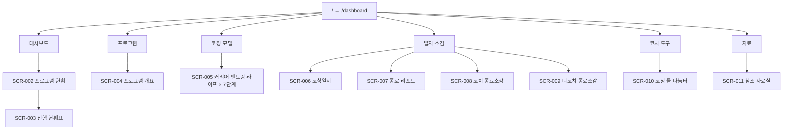

# 03. 정보 구조 설계서 (IA)

| 항목 | 내용 |
|---|---|
| 문서 ID | SCD-DOC-03 |
| 버전 | 0.1 |
| 상태 | 검토 대기 |
| 작성일 | 2026-10-15 |
| 작성 | Claude Code (개발 파트너) |
| 승인 | 프로젝트 오너 (사용자) |
| 상위 문서 | [00. 문서 인덱스](00.document-index.md) · 기능 [02. PRD/FS](02.PRD-FS-functional-spec.md) |

| 버전 | 날짜 | 변경 내용 |
|---|---|---|
| 0.1 | 2026-10-15 | 최초 작성 |

---

## 1. 구조 원칙

| 원칙 | 내용 |
|---|---|
| 보는 화면과 쓰는 화면 분리 | 가이드(프로그램·코칭 모델·코치 도구·자료)와 일지·소감을 다른 묶음에 둔다 |
| 화면마다 고유 주소 | 뒤로 가기·즐겨찾기·링크 공유가 그대로 동작하게 한다 |
| 깊이 3단계 이내 | 묶음 › 메뉴 › (유형 › 회차). 회차 화면까지 최대 3번 탭 |
| 외부 데이터 의존 최소화 | 외부 데이터가 필요한 화면은 SCR-002·003·011과 SCR-006~009의 선택 영역뿐 |

## 2. 사이트맵



텍스트 대체:
- `/` → `/dashboard`
- 대시보드: 프로그램 현황(SCR-002) → 진행 현황표(SCR-003)
- 프로그램: 프로그램 개요(SCR-004)
- 코칭 모델: 커리어·멘토링·라이프 각 7단계(SCR-005)
- 일지·소감: 코칭일지(SCR-006), 종료 리포트(SCR-007), 코치 종료소감(SCR-008), 피코치 종료소감(SCR-009)
- 코치 도구: 코칭 툴 나눔터(SCR-010)
- 자료: 참조 자료실(SCR-011)

**앱 셸 (SCR-001)**

```
┌──────────────────────────────────────────────────────────┐
│ ☰  [삼코동 로고]  삼코동 코칭 포털                         │ ← 상단 바
├──────────────┬───────────────────────────────────────────┤
│ 대시보드      │                                           │
│ 프로그램      │              본문 (화면별)                 │
│ 코칭 모델     │                                           │
│ 일지·소감     │                                           │
│ 코치 도구     │                                           │
│ 자료          │                                           │
└──────────────┴───────────────────────────────────────────┘
```

## 3. 화면 목록

| SCR | 화면 | 주소 | 기능 | 렌더링 | 정보 밀도 |
|---|---|---|---|---|---|
| SCR-001 | 앱 셸 (상단 바·사이드바) | 공통 | FN-001 | 정적 | 낮음 |
| SCR-002 | 프로그램 현황 | `/dashboard` | FN-007 | 서버 (300초 캐시) | 중간 (카드) |
| SCR-003 | 프로그램 진행 현황표 | `/dashboard/[programId]` | FN-008 | 서버 (300초 캐시) | 높음 (표) |
| SCR-004 | 프로그램 개요 | `/program/overview` | FN-003 | 정적 | 중간 |
| SCR-005 | 회차 가이드 | `/coaching/[type]/[stage]` | FN-004 | 정적 (21개 미리 생성) | 중간 |
| SCR-006 | 코칭일지 | `/records/journal` | FN-006 | 정적 + 선택 영역은 API-001 | 중간 |
| SCR-007 | 종료 리포트 | `/records/final-report` | FN-006 | 〃 | 중간 |
| SCR-008 | 코치 종료소감 | `/records/coach-reflection` | FN-006 | 〃 | 중간 |
| SCR-009 | 피코치 종료소감 | `/records/client-reflection` | FN-006 | 〃 | 중간 |
| SCR-010 | 코칭 툴 나눔터 | `/tools` | FN-005 | 정적 + iframe | 낮음 |
| SCR-011 | 참조 자료실 | `/references` | FN-009 | 서버 (300초 캐시) | 중간 (목록) |
| SCR-012 | 비밀번호 확인 | 모든 주소 (미인증 시) | FN-002 | 브라우저 기본 창 / 401 화면 | 낮음 |
| SCR-013 | 찾을 수 없음 | 존재하지 않는 주소 | FN-001 | 정적 | 낮음 |

- `[type]`: `career` · `mentoring` · `life`
- `[stage]`: `start` · `1` · `2` · `3` · `4` · `5` · `follow-up`
- 모든 화면은 코치 단일 역할, 비밀번호 확인 후 접근 (FN-002)

## 4. 이동·주소 상태 규칙

| 규칙 | 내용 |
|---|---|
| 첫 화면 | `/` 접속 시 `/dashboard`로 이동. 로고 클릭도 같음 |
| 필터 상태 | SCR-002 필터는 쿼리로 유지: `/dashboard?status=active&year=2026&round=2&type=career` |
| 일지·소감 선택값 | 쿼리로 유지: `/records/journal?program=2026-2-SNU-CAREER&client=C01&session=3` (고객 코드만, 이름·이메일 없음) |
| 사이드바 강조 | 주소 앞부분으로 결정. `/dashboard/*` → 프로그램 현황, `/coaching/career/*` → 커리어 펼침 + 해당 회차 |
| 회차 이동 | SCR-005 하단에 이전·다음 단계 링크 (같은 유형 안에서) |
| 외부 이동 | 구글폼·나눔터·드라이브 파일은 새 창 (`target="_blank" rel="noopener"`) + 새 창 표시 아이콘과 화면 낭독용 문구 |

## 5. 데이터 엔터티

| ENT | 엔터티 | 저장 위치 | 주요 필드 | 민감도 | 보관 |
|---|---|---|---|---|---|
| ENT-001 | Program | 시트 `programs` | programId, name, org, type, sessionCount, startDate, endDate, status, customFormUrls | 비민감 | 관리자 드라이브 기준 |
| ENT-002 | RosterEntry | 시트 `roster` | programId, clientCode, clientName, email, coachName, sessionDates[] | 개인정보 (이름·이메일) | 관리자 드라이브 기준 |
| ENT-003 | FormResponse | 응답 시트 ×4 | timestamp, programId, clientCode, sessionNo(일지만) + 문항 응답 | 민감 | 관리자 드라이브 기준 |
| ENT-004 | FormDefinition | `content/forms.json` | id, title, author, timing, formUrl, prefill, questions, updatedAt | 비민감 | 저장소 |
| ENT-005 | JourneyStage | `content/journey.json` | stage, name, coreQuestion, outputs, duration | 비민감 | 저장소 |
| ENT-006 | CoachingTypeGuide | `content/types/{type}.json` | type, stages[{stage, theme, purpose, questions, outputs, between}] | 비민감 | 저장소 |
| ENT-007 | ToolRecommendation | `content/tools.json` | id, name, purpose, stages[], types[], hubUrl | 비민감 | 저장소 |
| ENT-008 | ReferenceFile | 드라이브 "참조자료" 폴더 | id, name, mimeType, modifiedTime, webViewLink | 비민감 (내용은 관리자 책임) | 관리자 드라이브 |
| ENT-009 | CoachWorkflowStep | `content/coach-workflow.json` | step, name, description, linkTo | 비민감 | 저장소 |

**관계:** ENT-001 1 — N ENT-002 1 — N ENT-003 (키: programId + clientCode [+ sessionNo])

**시트 열 이름 (첫 행, 앱은 열 이름으로 읽음)**

| 시트 | 열 |
|---|---|
| `programs` | `programId`, `name`, `org`, `type`, `sessionCount`, `startDate`, `endDate`, `status`, `formUrl_journal`, `formUrl_finalReport`, `formUrl_coachReflection`, `formUrl_clientReflection` |
| `roster` | `programId`, `clientCode`, `clientName`, `email`, `coachName`, `session1Date` … `session5Date` (회기 수만큼) |
| 응답 시트 | 구글폼이 만드는 `타임스탬프` 열 + 폼 문항 제목. 키 문항 제목은 `programId`, `clientCode`, `sessionNo`로 고정 |

`programs`의 `status` 값: `준비` · `운영중` · `종료`. `formUrl_*`는 비우면 `forms.json`의 공용 폼을 쓴다.

## 6. API 목록

| API | 메서드·경로 | 목적 | 응답 | 권한 |
|---|---|---|---|---|
| API-001 | `GET /api/programs` | 프로그램 목록 + 프로그램별 고객 코드·회기 수·제출 합계 | `{ programs: [...], invalidCount, fetchedAt }` | 비밀번호 확인 후, 읽기 전용 |
| API-002 | `GET /api/programs/{programId}/progress` | 진행 현황표 데이터 | `{ program, rows: [{clientCode, cells}], notices, fetchedAt }` | 〃 |
| API-003 | `GET /api/references` | 참조자료 폴더 파일 목록 | `{ files: [...], fetchedAt }` | 〃 |

**공통 규칙**

| 항목 | 규칙 |
|---|---|
| 형식 | JSON, UTF-8. 날짜는 ISO 8601 (`2026-10-15`, `2026-10-15T09:00:00+09:00`) |
| 캐시 | 서버에서 300초 캐시 (`revalidate: 300`). `fetchedAt`에 원본 조회 시각 |
| 오류 | `{ error: { code, message } }`. 코드: `UNAUTHORIZED`(401), `NOT_FOUND`(404), `UPSTREAM_ERROR`(502), `MISCONFIGURED`(503) |
| 개인정보 | 응답에 `clientName`, `email`, 응답 문항 내용을 넣지 않는다 (RULE-003, RULE-008) |
| 쓰기 | 쓰기 API 없음 |

**API-002 응답 예 (가짜 데이터)**

```json
{
  "program": { "programId": "2026-2-DEMO-CAREER", "name": "예시 커리어 코칭", "sessionCount": 5, "status": "운영중" },
  "rows": [
    {
      "clientCode": "C01",
      "cells": {
        "journal-1": { "state": "submitted", "submittedAt": "2026-09-10" },
        "journal-2": { "state": "overdue" },
        "final-report": { "state": "planned" }
      }
    }
  ],
  "notices": { "unknownResponses": 1, "orderCheck": 0 },
  "fetchedAt": "2026-10-15T09:00:00+09:00"
}
```
